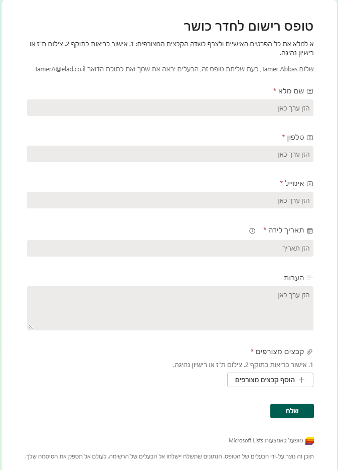
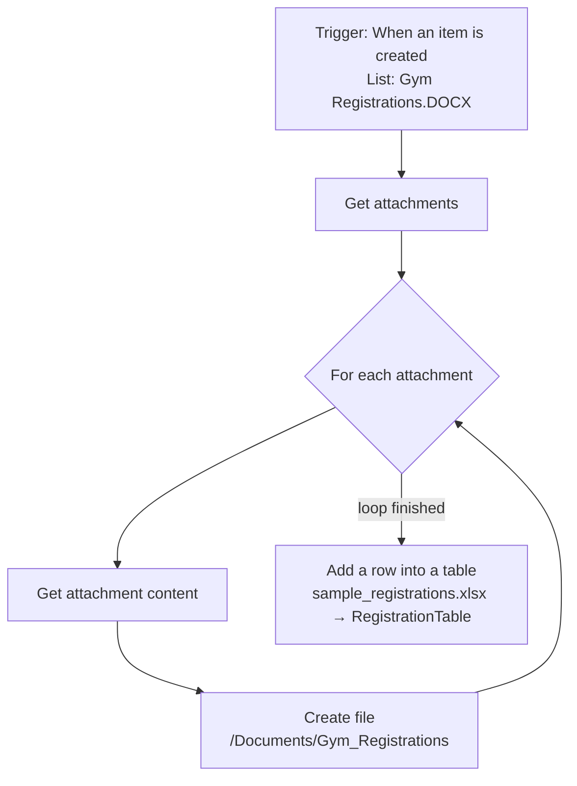

# Task 1: Gym Registration Automation (Power Automate)

A Power Automate cloud flow, **Process Gym Registration**, that processes gym registrations as they arrive. When a new registration is added to a Microsoft List, the flow:

1. copies every uploaded applicant document into a SharePoint / OneDrive folder, then
2. adds the applicant's details as one new row in an Excel table.

*The registration form (Microsoft Lists). It collects full name, phone, email, birth date, notes, and two required attachments: a valid health approval and an ID card or driver's license.*

---

## 1. Architecture & Workflow

### 1.1 Trigger

| Setting | Value |
|---------|-------|
| Connector | SharePoint (Microsoft Lists) |
| Operation | `When an item is created` |
| List | `Gym Registrations.DOCX` |
| Polling interval | Every 1 minute |
| Batch behavior | Split On is enabled, so each new item starts its own run |

### 1.2 Attachment Handling & File Archival

| Step | Action | Purpose |
|------|--------|---------|
| 1 | `Get attachments` | Gets the list of files attached to the new item (`itemId = triggerBody()?['ID']`). |
| 2 | `For each` over `body('Get_attachments')` | Repeats steps 3–4 for each attachment. |
| 3 | `Get attachment content` (inside the loop) | Downloads the file's content. |
| 4 | `Create file` (inside the loop) | Saves the file to `/Documents/Gym_Registrations` under its original name. |

### 1.3 Writing the Row to Excel

`Add a row into a table` (Excel Online (Business)) runs **after the loop has finished** (`runAfter: For_each = Succeeded`), not inside it. That way each registration produces exactly one row, however many files were attached.

- **File:** `sample_registrations.xlsx`
- **Table:** `RegistrationTable`

| Excel column | Source (list column) |
|--------------|----------------------|
| `FullName` | שם מלא (Full Name) |
| `Phone` | טלפון (Phone) |
| `Email` | אימייל (Email) |
| `BirthDate` | תאריך לידה (Birth Date) |
| `HealthApprovalLink` | אישור בריאות (Health Approval) |
| `IdDocumentLink` | ת"ז / רישיון (ID / Driver's License) |
| `Notes` | הערות (Notes) |

---

## 2. Repository Files

| File | Description |
|------|-------------|
| [`Process-Gym-Registration_20261010140646.zip`](./Process-Gym-Registration_20261010140646.zip) | The flow exported as an import package |
| [`sample_registrations.xlsx`](./sample_registrations.xlsx) | Excel file containing `RegistrationTable` (the flow's destination) |
| [`task1_automation.png`](./task1_automation.png) | Screenshot of the registration form |
| `screenshots/` | Run history and test screenshots |

---

## 3. Prerequisites

- A Microsoft 365 work or school account with **Power Automate** access (standard connectors only; no premium license needed).
- A **SharePoint site or OneDrive for Business** where you can:
  - create a Microsoft List with attachments enabled, and
  - create the folder `Documents/Gym_Registrations`.
- **Excel Online (Business)** access to a copy of `sample_registrations.xlsx`, uploaded to OneDrive or SharePoint.

---

## 4. Setup & Deployment

### 4.1 Prepare the data sources

1. **Create the Microsoft List** `Gym Registrations.DOCX` with these columns:

   | Column | Type |
   |--------|------|
   | שם מלא | Single line of text |
   | טלפון | Single line of text |
   | אימייל | Single line of text |
   | תאריך לידה | Date |
   | אישור בריאות | Single line of text / Hyperlink |
   | ת"ז / רישיון | Single line of text / Hyperlink |
   | הערות | Multiple lines of text |

   Attachments must be enabled (they are by default). The flow refers to columns by their internal names, so create the columns with exactly these Hebrew names.
2. **Create the archive folder** `Gym_Registrations` inside the site's `Documents` library.
3. **Upload `sample_registrations.xlsx`** to OneDrive or SharePoint. Make sure it contains an Excel table named `RegistrationTable` with the columns `FullName`, `Phone`, `Email`, `BirthDate`, `HealthApprovalLink`, `IdDocumentLink`, `Notes`.

### 4.2 Import the flow package

1. Go to [make.powerautomate.com](https://make.powerautomate.com), then **My flows → Import → Import Package (Legacy)**.
2. Upload `Process-Gym-Registration_20261010140646.zip`.
3. Under **Related resources**, click **Select during import** for each connection:
   - **SharePoint**: select or create a SharePoint connection.
   - **Excel Online (Business)**: select or create an Excel connection.
4. Click **Import**.

### 4.3 Reconnect to your own list, folder, and file

The package still points to the original author's OneDrive site, file, and table. After importing, open the flow in **Edit** mode and change these settings:

| Action | Field(s) to update |
|--------|--------------------|
| `When an item is created` | **Site Address**, **List Name** |
| `Get attachments` | **Site Address**, **List Name** |
| `Get attachment content` | **Site Address**, **List Name** |
| `Create file` | **Site Address**, **Folder Path** (`/Documents/Gym_Registrations`) |
| `Add a row into a table` | **Location**, **Document Library**, **File**, **Table** (`RegistrationTable`) |

If you pick a different list in the trigger, open `Add a row into a table` and check that each Excel column still has its field mapped (see the table in [section 1.3](#13-writing-the-row-to-excel)). Then **Save** and make sure the flow is **On**.

---

## 5. Verification & Testing

1. **Submit a test registration.** Open the list's form, fill in every field, attach two files (for example `health.pdf` and `id.jpg`), and submit.
2. **Check the run.** In Power Automate, open **Process Gym Registration → Run history**. A new run should appear within about one minute (the trigger checks every minute) with status **Succeeded**. Open it and confirm that:
   - `For each` ran once per attachment (2 iterations in this example), and
   - `Add a row into a table` ran **once**.
3. **Check the archived files.** Both attachments should be in `Documents/Gym_Registrations` under their original names.
4. **Check Excel.** Open `sample_registrations.xlsx`. `RegistrationTable` should have exactly **one** new row, with each value in the right column.
5. **Edge cases:**
   - **No attachments:** the loop runs zero times and the flow still adds the Excel row.
   - **Two registrations at once:** each item starts its own run (Split On), so you get two separate rows.
   - **Duplicate file names:** `Create file` fails if a file with the same name already exists in the folder, and the run is marked as failed. To avoid this, add the item ID to the file name, for example `@{triggerBody()?['ID']}_@{items('For_each')?['DisplayName']}`.

Screenshots of a successful run, the archive folder, and the Excel table belong in [`screenshots/`](./screenshots/).
