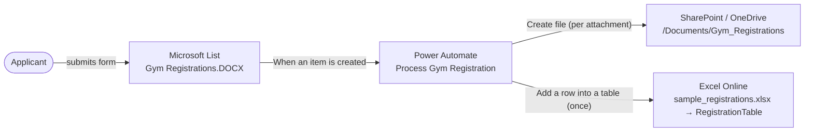
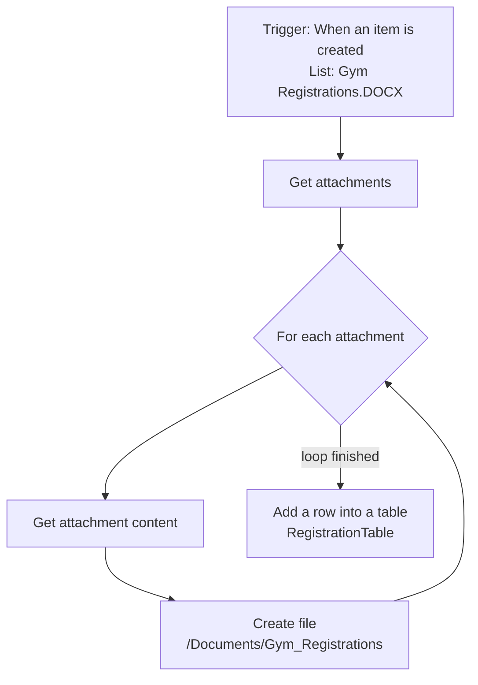

# Task 1: Gym Registration – Form, List & Power Automate

This task has two exercises:

| Exercise | What it covers |
|----------|----------------|
| **Exercise 1: Form & List Configuration** | A Microsoft Lists registration form that collects applicant details and two required documents, and an Excel file (`sample_registrations.xlsx`) set up to receive the records. |
| **Exercise 2: Power Automate Automation** | A cloud flow, **Process Gym Registration**, that runs for each new registration. It copies the uploaded documents into a SharePoint folder and adds the applicant as one row in the Excel table. |

---

## 1. Project Overview & Architecture



### Repository Files

```
task1_power_automate/
├── README.md                                     # This document
├── Process-Gym-Registration_20261010140646.zip   # Exported Power Automate package (Exercise 2)
├── sample_registrations.xlsx                     # Excel file containing RegistrationTable (Exercises 1 & 2)
├── task1_automation.png                          # Registration form screenshot (Exercise 1)
└── screenshots/                                  # Test evidence: run history, archive folder, Excel rows
```

---

## 2. Exercise 1: Form & List Configuration

### 2.1 Registration Form (Microsoft Lists)

The form is the Microsoft Lists form view of the `Gym Registrations.DOCX` list. Required fields are marked `*`.


| Form field | List column | Type | Required |
|------------|-------------|------|----------|
| Full Name | שם מלא | Single line of text | ✅ |
| Phone | טלפון | Single line of text | ✅ |
| Email | אימייל | Single line of text | ✅ |
| Birth Date | תאריך לידה | Date | ✅ |
| Notes | הערות | Multiple lines of text | |
| Attached files: a valid health approval and an ID card or driver's license | List item attachments | Attachments | ✅ |
| Health approval reference | אישור בריאות | Text / Hyperlink | |
| ID / license reference | ת"ז / רישיון | Text / Hyperlink | |

The form tells applicants to attach **two documents**: (1) a valid health approval and (2) a copy of their ID card or driver's license. These are saved as attachments on the list item, and the flow copies them to the archive in Exercise 2.

### 2.2 Excel File (`sample_registrations.xlsx`)

The workbook has one sheet containing an Excel table named **`RegistrationTable`** (range `A1:G…`). Power Automate's Excel connector can only add rows to a named table, not to a plain range.

| Column | Content | Example |
|--------|---------|---------|
| `FullName` | Applicant's full name | Israel Israeli |
| `Phone` | Contact phone number | 050-1234567 |
| `Email` | Contact email | israel@example.com |
| `BirthDate` | Date of birth | 1995-03-14 |
| `HealthApprovalLink` | Health approval reference | https://… |
| `IdDocumentLink` | ID / driver's license reference | https://… |
| `Notes` | Free-text notes | Morning sessions preferred |

---

## 3. Exercise 2: Power Automate Automation

### 3.1 Workflow Breakdown



**1. Trigger**

| Setting | Value |
|---------|-------|
| Connector | SharePoint (Microsoft Lists) |
| Operation | `When an item is created` |
| List | `Gym Registrations.DOCX` |
| Polling interval | Every 1 minute |
| Batch behavior | Split On is enabled, so each new item starts its own run |

**2. Copying the documents to the archive**

| Step | Action | Purpose |
|------|--------|---------|
| 2a | `Get attachments` | Gets the list of files attached to the new item (`itemId = triggerBody()?['ID']`). |
| 2b | `For each` over `body('Get_attachments')` | Repeats 2c–2d for each attachment. |
| 2c | `Get attachment content` | Downloads the file's content using its attachment ID. |
| 2d | `Create file` | Saves the file to `/Documents/Gym_Registrations` under its original name. |

**3. Writing the row to Excel**

`Add a row into a table` (Excel Online (Business)) runs **after the loop has finished** (`runAfter: For_each = Succeeded`), not inside it. That way each applicant produces exactly one row, however many files were attached.

| Excel column | Source (list column) |
|--------------|----------------------|
| `FullName` | שם מלא (Full Name) |
| `Phone` | טלפון (Phone) |
| `Email` | אימייל (Email) |
| `BirthDate` | תאריך לידה (Birth Date) |
| `HealthApprovalLink` | אישור בריאות (Health Approval) |
| `IdDocumentLink` | ת"ז / רישיון (ID / Driver's License) |
| `Notes` | הערות (Notes) |

---

## 4. Prerequisites & Cloud Connectors

**Accounts and access**
- A Microsoft 365 work or school account with **Power Automate** access. The flow uses only standard connectors, so no premium license is needed.
- A **SharePoint site or OneDrive for Business** where you can create a list and a document folder.

**Connectors used by the flow**

| Connector | Operations | Used for |
|-----------|------------|----------|
| SharePoint (`shared_sharepointonline`) | When an item is created · Get attachments · Get attachment content · Create file | Starting the flow, downloading attachments, archiving files |
| Excel Online (Business) (`shared_excelonlinebusiness`) | Add a row into a table | Adding the applicant row |

---

## 5. Setup & Deployment

### 5.1 Prepare the list, folder, and Excel file

1. **Create the Microsoft List** `Gym Registrations.DOCX` with the columns from [section 2.1](#21-registration-form-microsoft-lists), using exactly the Hebrew names shown, because the flow refers to columns by their internal names. Make sure attachments are enabled (they are by default).
2. **Create the archive folder** `Gym_Registrations` inside the site's `Documents` library.
3. **Upload `sample_registrations.xlsx`** to OneDrive or SharePoint, and check that `RegistrationTable` is still there (**Table Design → Table Name**).

### 5.2 Import the flow package

1. Go to [make.powerautomate.com](https://make.powerautomate.com), then **My flows → Import → Import Package (Legacy)**.
2. Upload `Process-Gym-Registration_20261010140646.zip`.
3. Under **Related resources**, click **Select during import** for each connection:
   - **SharePoint**: select or create a SharePoint connection.
   - **Excel Online (Business)**: select or create an Excel connection.
4. Click **Import**.

### 5.3 Reconnect to your own list, folder, and file

The package still points to the original author's OneDrive site, file, and table. Open the flow in **Edit** mode and change these settings:

| Action | Field(s) to update |
|--------|--------------------|
| `When an item is created` | **Site Address**, **List Name** |
| `Get attachments` | **Site Address**, **List Name** |
| `Get attachment content` | **Site Address**, **List Name** |
| `Create file` | **Site Address**, **Folder Path** (`/Documents/Gym_Registrations`) |
| `Add a row into a table` | **Location**, **Document Library**, **File**, **Table** (`RegistrationTable`) |

After changing the trigger's list, open `Add a row into a table` and check that each Excel column still has its field mapped (see [section 3.1](#31-workflow-breakdown)). Then **Save** and make sure the flow is **On**.

---

## 6. Verification & Testing

### 6.1 Test procedure

1. **Submit a registration.** Fill in every field of the form, attach two files (for example `health.pdf` and `id.jpg`), and submit.
2. **Check the run.** Open **Process Gym Registration → Run history**. A new run should appear within about one minute with status **Succeeded**. Open it and confirm that:
   - `For each` ran once per attachment (2 iterations here), and
   - `Add a row into a table` ran **once**.
3. **Check the archive.** Both files should be in `Documents/Gym_Registrations` under their original names.
4. **Check Excel.** `RegistrationTable` should have exactly **one** new row, with each value in the right column.

### 6.2 Test cases

| # | Scenario | Expected result |
|---|----------|-----------------|
| 1 | Registration with 2 attachments | 2 files archived, 1 Excel row added |
| 2 | Registration with no attachments | The loop runs 0 times; 1 Excel row is still added |
| 3 | Two registrations submitted at the same time | Two separate runs (Split On); 2 Excel rows |
| 4 | Attachment name already exists in the archive folder | `Create file` fails and the run is marked **Failed** (see the note below) |

> **Note:** To avoid test case 4 in production, add the item ID to the file name, for example `@{triggerBody()?['ID']}_@{items('For_each')?['DisplayName']}`.

### 6.3 Evidence

Screenshots in [`screenshots/`](./screenshots/):

- Flow run history showing successful runs
- Run details: the `For each` iterations and a single `Add a row into a table` step
- The `Gym_Registrations` archive folder containing the uploaded files
- `RegistrationTable` with the new applicant rows
