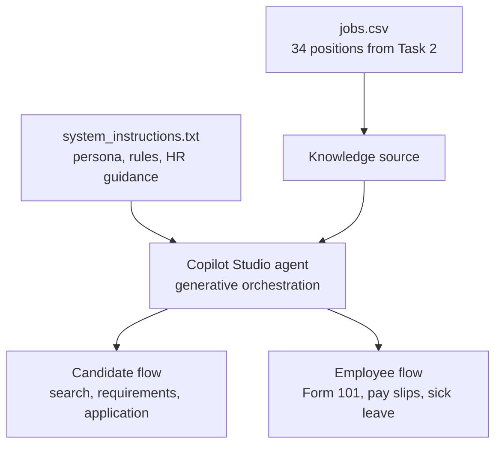

# Task 3: Paz HR Virtual Assistant (Microsoft Copilot Studio)

A Hebrew-first conversational agent built in **Microsoft Copilot Studio** that serves two audiences:

- **Job candidates**: find open positions at Paz, check requirements, and start an application.
- **Current employees**: get answers to routine HR questions (Form 101, pay slips, sick-leave reporting).

Job answers are grounded on `jobs.csv`, the 34 positions scraped from the Paz careers site in [Task 2](../task2_scraping/).

---

## Live Interactive Demo

You can try the agent directly in Copilot Studio:

👉 **[Paz HR Assistant Live Demo](https://copilotstudio.microsoft.com/environments/Default-18971179-f37c-4b7b-b37a-0a9d8615af94/bots/cr10a_pazhrassistant_mb229K/canvas?__version__=2&enableFileAttachment=false&cliAgent=true)**

> If the link asks for access you don't have, the [test scenarios](#3-test-scenarios) and [screenshots](./screenshots/) show the full session.

---

## 1. Architecture

| Component | Configuration |
|-----------|---------------|
| Platform | Microsoft Copilot Studio (published agent: *Paz HR Assistant*) |
| Knowledge | `jobs.csv` uploaded as a knowledge file (fields: `title`, `department`, `link`, `description`, `date`) |
| Web search | Disabled, so the agent answers only from the dataset and its instructions |
| Instructions | [`system_instructions.txt`](./system_instructions.txt) |
| Language | Hebrew by default; switches to English if the user writes in English |

---

## 2. Design Principles

**Answers come only from the knowledge base.** The agent recommends only roles that exist in `jobs.csv` and links each one to its official page (`https://www.paz.co.il/jobs/...`). If a role, region, or detail is missing, it says so and suggests the closest real alternatives (see tests 4, 7, 9, 13).

**The application stays open across topics.** Once a candidate starts applying (test 3), the agent keeps that application open through later, unrelated questions and reminds the user which details are still missing (tests 4–10). It also fills in the signed-in user's name and email and asks the user to confirm them instead of asking for them again.

**Each audience gets its own flow.** Candidate questions are answered from the jobs data. Employee questions follow the HR policy rules in the system instructions: Hilan / the Paz employee portal, pay slips released on the 9th, and the sick-leave upload process.

---

## 3. Test Scenarios

All tests ran in one continuous session in the Copilot Studio test pane.

| # | Category | User query | Observed behavior | Evidence |
|---|----------|------------|-------------------|----------|
| 1 | Greeting & scope | "היי צאט, אני צריך שתעזור לי בעברית בבקשה" | Switched to Hebrew, introduced itself, and listed its three capabilities and the main departments. | [01](./screenshots/01_greeting_and_scope.png) |
| 2 | Department search | "אילו משרות פתוחות קיימות כרגע בתחום הכספים והחשבונאות?" | Listed all 6 finance positions with responsibilities and direct links, and suggested one related role (payroll assistant). | [02](./screenshots/02_finance_jobs_search.png) |
| 3 | Application intake | "אני רוצה להגיש מועמדות לתפקיד מנהל/ת חשבונות ספקים" | Confirmed the target role, restated its mandatory requirements (bookkeeping certificate, levels 1+2; Office), and asked for name, phone, and email, with the name and email pre-filled from the signed-in profile. | [03](./screenshots/03_application_intake.png) |
| 4 | Location search | "האם יש לכם משרות באזור חיפה והצפון?" | Checked all 34 positions and stated that none is listed in Haifa or the North; the only locations mentioned are Rishon LeZion and Be'er Sheva. Offered nationwide and regional roles instead. | [04](./screenshots/04_region_search_haifa_north.png) |
| 5 | Requirements | "מה הדרישות והניסיון הנדרש לתפקיד נהג/ת חלוקה?" | Noted that no role has that exact title and offered the 2 closest driver roles, with license (up to 12 tons), location, hours (06:00–14:00), and conditions. | [05](./screenshots/05_driver_requirements.png) |
| 6 | Retail / Yellow | "איזה תפקידים פתוחים קיימים ברשת yellow או בתחום הקמעונאות?" | Listed 8 retail positions grouped by type, and pointed out which listings contain only a title and no details. | [06](./screenshots/06_retail_yellow_search.png) |
| 7 | **Negative: missing role** | "האם יש לכם משרה פתוחה של מתכנת או מהנדס תוכנה Full Stack?" | Stated that none of the 34 positions is a software role and that there is no IT department. Offered the closest analytical roles and a link to the careers page. | [07](./screenshots/07_negative_case_fullstack.png) |
| 8 | Shifts & students | "האם יש משרות שמתאימות למשמרות או לסטודנטים?" | Stated that no role is marked as suitable for students or part-time. Listed the shift-based roles and flagged the salesclerk role as a *possible* fit only. | [08](./screenshots/08_shifts_and_students.png) |
| 9 | **Negative: process timeline** | "מה קורה אחרי שאני משאיר פרטים, ומתי חוזרים אליי?" | Explained the application steps but said plainly that it has no information on response times. | [09](./screenshots/09_recruitment_process_faq.png) |
| 10 | Employee: Form 101 | "אני עובד חדש בחברה, איך ומתי אני ממלא טופס 101?" | Explained that the form is filled in digitally via Hilan / the Paz portal when starting the job and updated each January, which supporting documents to attach, and where to get help. | [10](./screenshots/10_form_101.png) |
| 11 | Employee: pay slips | "איפה אני יכול לצפות בתלוש המשכורת שלי, ובאיזה תאריך הוא מתעדכן?" | Pointed to the Paz portal / Hilan app and said slips are released on the 9th of each month. | [11](./screenshots/11_pay_slips.png) |
| 12 | Employee: sick leave | "למי אני מעביר אישור מחלה על היעדרות?" | Described both submission routes (attendance system upload or direct manager) with practical tips. | [12](./screenshots/12_sick_leave.png) |
| 13 | **Negative: unknown policy detail** | "האם חייבים לצרף תעודת זהות + ספח עבור טופס 101?" | Said this detail is not in its sources instead of guessing, and pointed the user to the portal and the payroll & HR help desk. | [13](./screenshots/13_form_101_unknown_detail.png) |

---

## 4. Known Limitations

- **No real HR system integration.** The application flow collects candidate details in the conversation but does not write them to an ATS or CRM. The next step would be a Power Automate flow that saves applications to Dataverse or SharePoint and notifies the recruitment team.
- **Limited by the source data.** Some scraped listings contain only a title, and the `date` field is empty for every listing, so the agent cannot give details or posting dates for those roles.
- **Employee answers come from the system instructions**, not from a policy document. Connecting the official HR policy documents as a second knowledge source would widen what employees can ask about.

---

## 5. Files in This Directory

| File | Description |
|------|-------------|
| `README.md` | This document: architecture, design principles, test scenarios, and evidence |
| [`system_instructions.txt`](./system_instructions.txt) | The full instructions configured in Copilot Studio (persona, grounding rules, application flow, HR guidance) |
| [`screenshots/`](./screenshots/) | 13 screenshots of the test session, numbered to match the table above |
